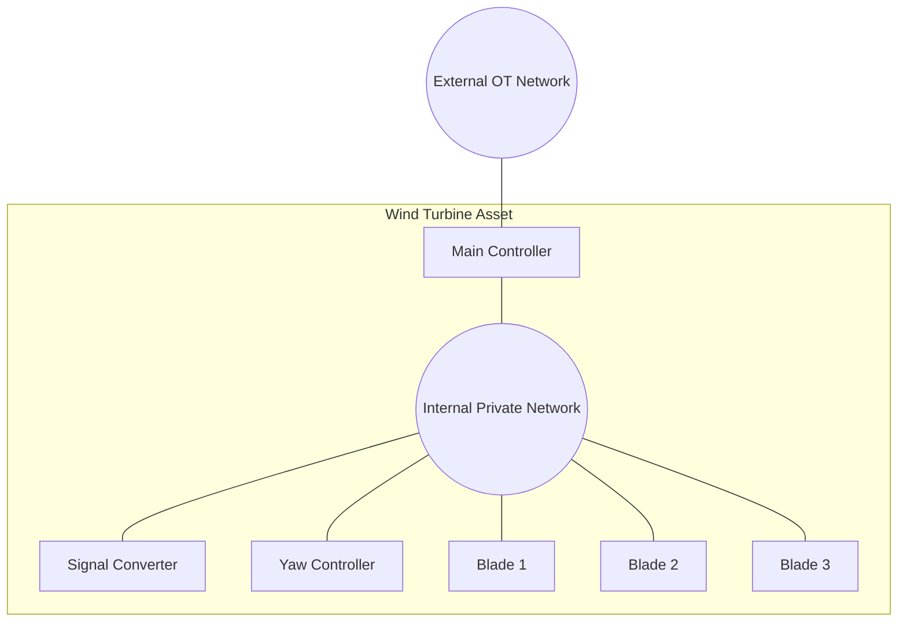

# Wind Turbine Scale Plugin

The **Wind Turbine Plugin** is a domain-specific plugin for the Scale App designed to simulate large-scale wind farms using the OT-Sim framework. It automates the complex topology generation required for high-fidelity wind turbine simulation.

## Architecture

Each "Wind Turbine" asset is composed of **6 distinct containers** connected by a private internal network:
1.  **Main Controller**: Runs control logic, DNP3 server, and Modbus client.
2.  **Signal Converter**: Simulates Anemometer (Wind Speed/Dir).
3.  **Yaw Controller**: Simulates nacelle rotation.
4.  **Blade 1, 2, 3**: Simulates blade pitch actuators.

The plugin packs these containers onto VMs based on the configured density.



## Configuration

### Core Fields

| Field | Type | Default | Description |
| :--- | :--- | :--- | :--- |
| `name` | String | `"wind-turbine"` | The prefix used for generating VM hostnames (e.g., `wind-turbine-1`). Letters, digits and `-`, starting with a letter or digit, at most 58 characters. |
| `count` | Integer | `1` | The number of **Wind Turbines** to simulate (not VMs). |
| `containers_per_node` | Integer | `6` | Containers per VM; must be at least 6 and a multiple of 6 (e.g., 18 for 3 turbines/VM). A turbine's private network cannot span VMs. |
| `node_template` | Dict | `{}` | VM hardware specifications (CPU, RAM, Network). |
| `container_template` | Dict | `{}` | Configuration for the turbine containers (e.g. `external_network`, `cpu`, `memory`). |

### Metadata Sections

*   **`templates`**: Defines the OT-Sim configuration for the turbine components (logic, physics, protocols).
*   **`helics`**: Configures the HELICS co-simulation federation (Broker, Endpoint, Topic).
*   **`ground-truth-module`**: Configures Elasticsearch exfiltration for simulation data.

### Container assets

`container_template.rootfs` names an existing filesystem on the **nested VM**
(default `otsimfs.tgz`). Alternatively, set `container_template.rootfs_source`
to a head-node `.tgz` file: the plugin injects it into each VM as
`/scale/rootfs/otsimfs.tgz`, outside the shared weather volume, and uses that
path in the generated minimega script.
The rootfs must provide `/init`, miniccc on `/cc`, and the configured OT-sim
modules; a plain OT-sim Docker export without an init/agent is insufficient.

`templates.default.anemometer.weather.replayData` is a head-node CSV path,
injected into each VM and mounted at `/shared/weather.csv` in containers.
Column names must match the CSV exactly.

Optional `templates.default.main-controller.node-red.flow` (singular) names a
head-node JSON flow. It is copied into the main controller's config directory
and loaded from `/etc/ot-sim/node-red.json`. Node-RED is not required for the
turbine's control logic.

For all assets, a Scale Scenario/Topology, verified public weather data,
image recipes, Grafana provisioning, and deployment/verification commands, see
the [complete example in sceptre-phenix-topologies](https://github.com/sandialabs/sceptre-phenix-topologies/tree/main/renewables/wind/wind-scale).

## Networking

The plugin manages two layers of networking:

1.  **Internal Network (Private)**:
    *   Used for communication between components of the same turbine (Modbus).
    *   Uses static IPs (e.g., `10.135.1.x`) reused across all turbines (isolated by VLANs).

2.  **External Network (OT)**:
    *   Used for SCADA communication (DNP3) and HELICS.
    *   Only the **Main Controller** is connected to this network.
    *   IPs are assigned sequentially based on the `external_network` CIDR.

## Implementation Details

### Template Override

The Wind Turbine plugin overrides the default Scale app template to support its specific networking and volume mounting requirements.

*   **Template**: `templates/wind_turbine.mako` (relative to plugin source).
*   **Customization**:
    *   **Namespace**: Sets minimega namespace to `wind`.
    *   **Container Naming**: Uses `wtg-{turbine_num}-{component_type}` pattern.
    *   **Volumes**:
        *   Mounts the generated OT-sim configuration directory (`/scale/<hostname>/<i>/`) to `/etc/ot-sim/` inside the container.
        *   Mounts a shared weather data directory if replay data is configured.
    *   **Networking**: Configures multiple interfaces for the Main Controller (external + private) and single interfaces for other components (private).

## Example Profile

```yaml
- name: wind-farm
  plugin: wind_turbine
  count: 30                # 30 Turbines (180 Total Containers)
  containers_per_node: 18  # 3 Turbines per VM -> 10 VMs Total
  container_template:
    external_network:
      name: ot
      network: 192.168.100.0/24
      gateway: 192.168.100.254
  helics:
    federate: OpenDSS
    topic: "{{turbine_name}}.power"
```

## Generated Artifacts

For each node, the plugin generates:
1.  **Minimega Config**: Launches the containers and configures networking.
2.  **OT-Sim Configs**: XML files for every module (Logic, Modbus, DNP3) in every container.
3.  **Tarball**: A `wind-configs.tgz` file containing all XMLs, injected into the VM.
4.  **HELICS Annotations**: Instructions for the HELICS app to launch brokers if needed.

## Testing

### Unit Tests
The plugin tests cover configuration parsing, IP calculation, container details,
and real configure/post-start artifact generation using local test fixtures.
The companion topology repository tests its deployable resources separately.

To run the tests:
```bash
pytest phenix_apps/apps/scale/plugins/wind_turbine/tests
```

### Dry-Run
A dry-run input is provided in `tests/test_wind_turbine_input.yaml` beside this
README. This file defines a scenario with 30 wind turbines; replace its external
asset paths before running configure.

To execute a dry-run:
```bash
PHENIX_LOG_FILE="" phenix-app-scale configure --dry-run < phenix_apps/apps/scale/plugins/wind_turbine/tests/test_wind_turbine_input.yaml
```